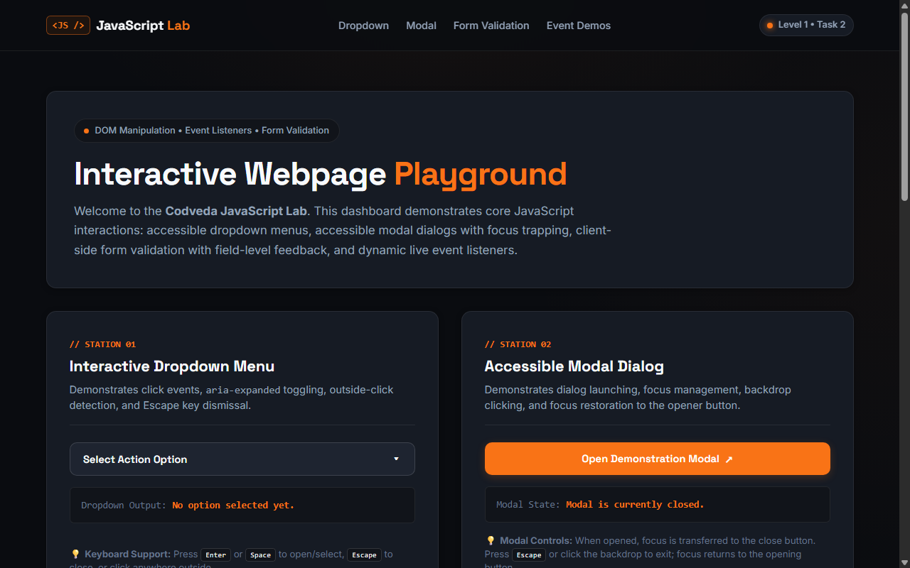

# JavaScript Lab — Interactive Webpage

**Track:** Level 1 — Basic Web Development  
**Task:** Task 2 — Introduction to JavaScript (Interactive Webpage)  
**Author:** Suvro Mahir Arman ([@suvromahiarman-star](https://github.com/suvromahiarman-star))  
**Tech Stack:** Pure Vanilla JavaScript (ES6+), Semantic HTML5, Modern CSS3 (Zero Frameworks, Zero External Dependencies)

---

## 📸 Visual Preview



---

## 📌 Project Overview

**JavaScript Lab — Interactive Playground** is an educational frontend application built for **Level 1, Task 2** of the **Codveda Web Development Internship**.

The project demonstrates essential client-side JavaScript techniques across four dedicated stations:
1. **Interactive Dropdown Menu:** Toggle on click, outside-click detection, Escape key dismissal, and keyboard arrow navigation.
2. **Accessible Modal Dialog:** Focus-trapped dialog overlay, backdrop click-to-dismiss, Escape key handling, and opener focus restoration.
3. **Client-Side Form Validation:** Real-time input validation, submission interception via `e.preventDefault()`, field-level error feedback with ARIA live announcements, and secure credential handling.
4. **Live Event & State Counters:** Real-time character counter with `input` listeners and an interactive counter demonstrating numerical state manipulation.

---

## 🎯 Official Task Objectives & Fulfillment

| Official Codveda Objective | Implementation Detail | Status |
| :--- | :--- | :---: |
| **1. Create interactive elements (dropdowns, modals, forms)** | Created custom accessible dropdown (`#station-dropdown`), focus-trapped modal dialog (`#station-modal`), and a multi-field demo registration form (`#station-form`). | ✅ Completed |
| **2. Write basic JS functions & event listeners** | Built modular functions (`openDropdown`, `closeModal`, `validateField`, `updateCounterDisplay`) listening to `click`, `input`, `keydown`, `submit`, and `reset` events. | ✅ Completed |
| **3. Validate form inputs using JavaScript** | Implemented client-side validation for required fields, email format regex, minimum 8-character password length with digit requirement, and password confirmation matching. | ✅ Completed |

---

## 💡 JavaScript Concepts Demonstrated & Explained

### 1. The Document Object Model (DOM) & Selection
- Elements are selected using `document.getElementById()` and `document.querySelectorAll()`.
- Example:
  ```javascript
  const triggerBtn = document.getElementById('dropdown-trigger');
  const menuItems = dropdownMenu.querySelectorAll('.dropdown-item');
  ```
- *Why:* Direct ID and class selections provide clean, performant access to DOM nodes without library abstractions.

### 2. Event Listeners & The Event Object (`e` / `event`)
- **Listening to Events:** Used `addEventListener()` to bind custom logic to user interactions (`click`, `input`, `keydown`, `submit`).
- **Preventing Default Actions (`e.preventDefault()`):**
  ```javascript
  form.addEventListener('submit', (event) => {
    event.preventDefault(); // Prevents page reload so JS can validate in-place
    ...
  });
  ```
- **Stopping Propagation (`e.stopPropagation()`):** Used on dropdown toggle to prevent the global document click listener from closing the menu on the opening click.

### 3. Accessible Focus Management
- **Focus Transfer:** When the modal opens, JavaScript transfers focus to the dialog close button (`closeModalIcon.focus()`).
- **Focus Restoration:** Before opening, JavaScript captures `document.activeElement`. Upon closing, focus is automatically restored back to the opening button (`previouslyFocusedElement.focus()`).
- **Focus Trap:** When pressing <kbd>Tab</kbd> or <kbd>Shift + Tab</kbd> inside the modal, focus cycles continuously within dialog controls rather than leaking into the background page.

### 4. Dynamic ARIA & State Updates
- Synchronizes visual states with screen-reader states:
  - `triggerBtn.setAttribute('aria-expanded', 'true');`
  - `inputElement.setAttribute('aria-invalid', 'true');`
  - Feedback regions equipped with `role="alert"` and `aria-live="polite"`.

### 5. String Manipulation & Regular Expressions
- Input sanitization with `value.trim()`.
- Pattern matching for email addresses:
  ```javascript
  const emailRegex = /^[^\s@]+@[^\s@]+\.[^\s@]+$/;
  const isValid = emailRegex.test(value);
  ```
- Password complexity checks ensuring $\ge 8$ characters and at least one numeric digit (`/\d/.test(value)`).

---

## 📂 Project Directory Structure

```text
JavaScript-Interactivity/
├── index.html       # Semantic HTML5 document containing all 4 interactive stations
├── styles.css       # Design tokens, validation states (valid/invalid), modal overlay, and responsive rules
├── script.js        # Modular vanilla JavaScript loaded with defer
└── README.md        # Technical documentation, concepts, and testing checklist
```

---

## 🚀 How to Run Locally

Because this project is built with vanilla HTML, CSS, and JavaScript, it runs in any modern web browser without dependencies, Node build steps, or compilation.

### Option 1: Direct File Launch
Double-click `index.html` or open it in your browser:
```text
file:///D:/Codveda%20Tech%20Intern/Level-1-Basic/JavaScript-Interactivity/index.html
```

### Option 2: Local HTTP Server (Python)
```powershell
# From D:\Codveda Tech Intern\Level-1-Basic\JavaScript-Interactivity\
python -m http.server 8080
```
Then visit `http://localhost:8080` in your web browser.

---

## 🧪 Testing Checklist & Verification Results

| Test Case | Scenario / Interaction | Expected Result | Actual Result |
| :--- | :--- | :--- | :---: |
| **Dropdown Toggle** | Click dropdown button | Menu reveals; `aria-expanded="true"`; chevron rotates. | ✅ Pass |
| **Dropdown Outside Click** | Click anywhere outside menu | Menu closes automatically; `aria-expanded="false"`. | ✅ Pass |
| **Dropdown Escape Key** | Press <kbd>Escape</kbd> when menu is open | Menu closes; focus returns to dropdown button. | ✅ Pass |
| **Dropdown Keyboard Arrows** | Press <kbd>&darr;</kbd> or <kbd>&uarr;</kbd> on menu items | Focus cycles through dropdown options. | ✅ Pass |
| **Modal Open** | Click "Open Demonstration Modal" | Backdrop displays; background scroll locked; focus inside dialog. | ✅ Pass |
| **Modal Focus Trap** | Press <kbd>Tab</kbd> repeatedly | Focus cycles only between close button and action buttons. | ✅ Pass |
| **Modal Dismissal** | Click backdrop OR press <kbd>Escape</kbd> OR click close | Modal closes; scroll restored; focus returns to opener button. | ✅ Pass |
| **Form Empty Submission** | Click submit with blank inputs | All 4 fields flagged `.is-invalid`; error messages shown; first invalid field focused. | ✅ Pass |
| **Form Email Validation** | Enter `notanemail` | Field flagged; message: "Please enter a valid email format". | ✅ Pass |
| **Form Password Length** | Enter `abc1` (< 8 chars) | Field flagged; message: "Password must be at least 8 characters long." | ✅ Pass |
| **Form Password Number** | Enter `abcdefgh` (no number) | Field flagged; message: "Password must contain at least one number." | ✅ Pass |
| **Form Password Match** | Enter mismatched confirm password | Confirm field flagged; message: "Passwords do not match." | ✅ Pass |
| **Form Valid Submission** | Enter all valid details | Success banner appears; passwords wiped immediately; no page reload. | ✅ Pass |
| **Live Character Counter** | Type into textarea | Remaining characters decrement live; badge turns red when $\le 15$ chars left. | ✅ Pass |
| **Interactive State Counter** | Click +1, -1, Reset | Counter number updates immediately; status label changes (Positive/Negative/Neutral). | ✅ Pass |
| **Responsive Check** | View at 375px, 768px, 1440px | No horizontal overflow; form adapts to 1 column on mobile; touch targets $\ge 44\text{px}$. | ✅ Pass |

---

## 🎥 Internship Evaluation Demonstration Checklist

When recording your internship explanation or walkthrough:
1. **Dropdown Demo:**
   - Click to open & show `aria-expanded` changing in DevTools.
   - Click outside to show outside-click detection.
   - Open again and press <kbd>Escape</kbd> to demonstrate keyboard accessibility.
2. **Modal Demo:**
   - Click button to launch modal dialog.
   - Press <kbd>Tab</kbd> to show focus trapping within dialog buttons.
   - Press <kbd>Escape</kbd> or click backdrop to close, pointing out focus restoration to the opener button.
3. **Form Validation Demo:**
   - Submit empty form to show field-specific error messages.
   - Enter invalid email (`test@`) & short password (`123`) to show real-time error messages.
   - Enter valid details to show successful submission banner with `e.preventDefault()`, explaining that passwords are removed from memory immediately.
4. **Event Demos:**
   - Type in textarea to show live `input` character counting.
   - Click +1 / -1 / Reset to show variable state tracking.

---

## 🔒 Known Limitations & Privacy Assurance
- **Client-Side Learning Demo:** This project runs strictly in the browser. Form data is validated client-side and is never sent to a remote API or persistent database.
- **Credential Safety:** Passwords are not stored, logged to console, or retained in variables after validation completes.

