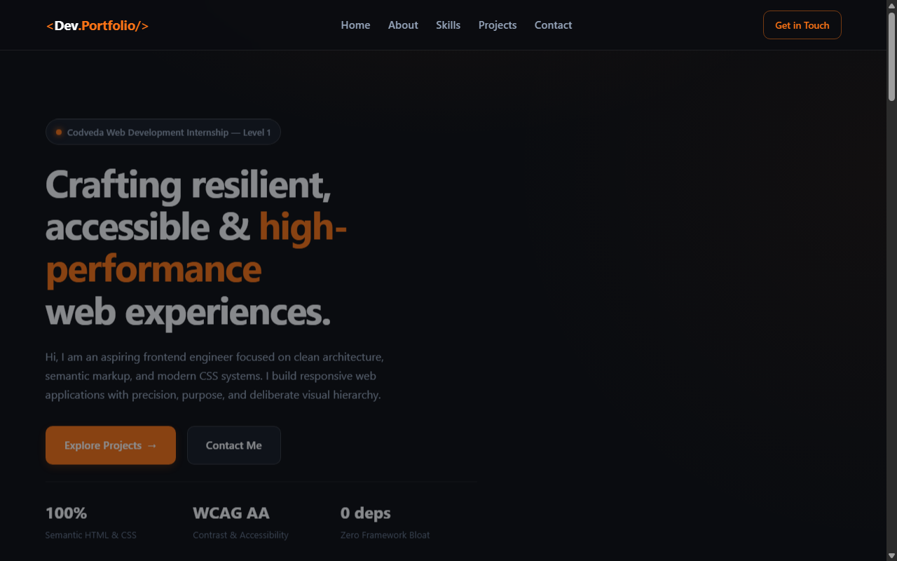

# Portfolio Webpage — Codveda Web Development Internship

**Track:** Level 1 — Basic Web Development  
**Task:** Task 1 — Portfolio Webpage  
**Author:** Suvro Mahir Arman ([@suvromahiarman-star](https://github.com/suvromahiarman-star))  
**Stack:** Pure Semantic HTML5, Modern CSS3 (Zero Frameworks, Zero Runtime Dependencies)

---

## 📸 Visual Preview



---

## 📌 Project Overview

This project is a personal developer portfolio webpage designed and built from scratch to fulfill **Level 1, Task 1** of the **Codveda Web Development Internship**.

The portfolio showcases web engineering skills, practical projects, technical proficiencies, and direct contact options. It adheres to strict frontend standards: semantic HTML5 landmarks, responsive layout systems (CSS Grid & Flexbox), fluid typography, custom design tokens, accessible color contrasts, and subtle CSS animations with reduced-motion accommodations.

---

## 🎯 Official Task Objectives & Fulfillment

| Official Requirement | Implementation Detail | Status |
| :--- | :--- | :---: |
| **1. Single-Page Layout** | Created using semantic HTML5 sections (`#hero`, `#about`, `#skills`, `#projects`, `#contact`) connected via responsive sticky navigation and smooth anchor scrolling. | ✅ Completed |
| **2. Core Sections** | Includes **Introduction** (Hero with asymmetric layout and developer highlight), **About** (professional bio and principles), **Skills** (categorized proficiencies), **Projects** (curated project cards with tech tags), and **Contact Information** (direct email and verified profile links). | ✅ Completed |
| **3. Custom Fonts, Colors & Animations** | Styled with a deep charcoal theme (`#0a0c10`), warm white text (`#f8fafc`), and vivid orange accents (`#f97316`). Powered by Space Grotesk and Inter Google Fonts, responsive design tokens, CSS keyframe entrance transitions, and hover micro-interactions. | ✅ Completed |

---

## ✨ Features & Architecture Highlights

1. **Original Visual Identity:**
   - Deep charcoal background with subtle radial gradient lighting.
   - Distinctive warm-white typography and high-contrast orange accenting.
   - Pure CSS visual artifact: An asymmetric, interactive-styled code terminal card highlighting developer configuration tokens.

2. **Clean HTML5 Semantic Hierarchy:**
   - Document landmarks (`<header>`, `<nav>`, `<main>`, `<section>`, `<article>`, `<footer>`).
   - Accessible skip link (`.skip-link`) for keyboard-first navigation.
   - Screen-reader friendly attributes and meaningful heading progression (`h1` &rarr; `h2` &rarr; `h3` &rarr; `h4`).

3. **Modern CSS3 Design System:**
   - Centralized `:root` custom properties for colors, spacing scales, border-radii, and transition timing.
   - CSS Grid and Flexbox for adaptive component arrangements.
   - Fluid typography with `clamp()` and dynamic viewport units (`dvh`).

4. **Accessibility & Motion Safety:**
   - WCAG AA contrast compliant for all text and UI elements.
   - Visible `:focus-visible` outline rings for keyboard accessibility.
   - Full `@media (prefers-reduced-motion: reduce)` override disabling transforms and animations for sensitive users.

5. **Honest, Standards-Compliant Content:**
   - Real, authentic project references (including the full-stack e-commerce platform and this portfolio project).
   - No fake submission forms claiming backend email delivery; provides genuine `mailto:` and profile links.
   - No misleading percentage bars or arbitrary proficiency meters.

---

## 🛠️ Technologies Used

- **HTML5:** Semantic document markup, native metadata, accessibility attributes.
- **CSS3:** Custom properties (CSS variables), Grid, Flexbox, media queries, keyframe animations, pseudo-classes (`:focus-visible`, `:hover`, `::after`).
- **Typography:** Google Fonts (`Space Grotesk` for display headings, `Inter` for body copy).
- **Tooling:** Zero build steps, compilers, or heavy libraries required. Runs natively in any modern web browser.

---

## 📂 Project Directory Structure

```text
Portfolio-Webpage/
├── index.html       # Semantic single-page HTML5 document
├── styles.css       # Complete CSS3 stylesheet with design tokens and responsive queries
└── README.md        # Project documentation, verification results, and run guide
```

---

## 🚀 How to Run the Webpage Locally

Because this project uses pure HTML5 and CSS3 without build dependencies or package managers, it can be previewed immediately:

### Option 1: Direct File Launch
Double-click `index.html` or open it directly in any modern browser:
```text
file:///D:/Codveda%20Tech%20Intern/Level-1-Basic/Portfolio-Webpage/index.html
```

### Option 2: Local HTTP Server (Recommended)
Using Python:
```powershell
# From D:\Codveda Tech Intern\Level-1-Basic\Portfolio-Webpage\
python -m http.server 3000
```
Then visit `http://localhost:3000` in your browser.

Using Node.js (`npx serve`):
```powershell
npx serve .
```

---

## 🧪 Testing Checklist & Verification Results

| Test Category | Target Width / Environment | Verification Performed | Result |
| :--- | :--- | :--- | :---: |
| **Mobile Layout** | 375px (Viewport width) | Horizontal overflow check, navigation wrap/scroll, full-width button adaptation, single-column grid. | ✅ Pass |
| **Tablet Layout** | 768px (Viewport width) | Two-column to single-column hero adaptation, card grid alignment, spacing rhythm. | ✅ Pass |
| **Desktop Layout** | 1440px (Viewport width) | Asymmetric hero grid, 3-column project cards, max-width container bounds (1200px). | ✅ Pass |
| **Navigation & Anchors** | All viewports | Anchor links jump to `#hero`, `#about`, `#skills`, `#projects`, `#contact`, and `#top` with smooth scroll and header offset padding. | ✅ Pass |
| **Keyboard Navigation** | Desktop | Tab key focuses all links and buttons with high-contrast visible focus rings. Skip link displays upon initial tab. | ✅ Pass |
| **Reduced Motion** | `prefers-reduced-motion` | All animations, transitions, and hover transforms instantly disabled. | ✅ Pass |
| **Framework Constraints** | Repository check | Zero JavaScript files, zero React/Tailwind/Bootstrap dependencies. Pure HTML & CSS. | ✅ Pass |

---

## 📸 Submission Screenshot Instructions

For your internship submission:
1. **Desktop View:** Open `index.html` at 1440px width. Capture the Hero section and Featured Projects section.
2. **Mobile View:** Open browser DevTools (`F12`), toggle Device Toolbar (`Ctrl + Shift + M`), select **iPhone 12/13/14 (390px)** or **375px**. Capture the responsive header, stacked hero, and project cards.
3. Save screenshots into an `assets/screenshots/` folder if required for Codveda submission.

---

## 🔗 Official Repository & Contact Links

- **GitHub Repository:** [codveda-intern-level-01-task-1](https://github.com/suvromahirarman-star/codveda-intern-level-01-task-1.git)
- **Developer GitHub Profile:** [suvromahirarman-star](https://github.com/suvromahirarman-star)
- **LinkedIn Profile:** [Mahir Arman Suvro](https://www.linkedin.com/in/mahir-arman-suvro-8b24b5438/)
- **Contact Email:** `suvromahirarman@gmail.com`


