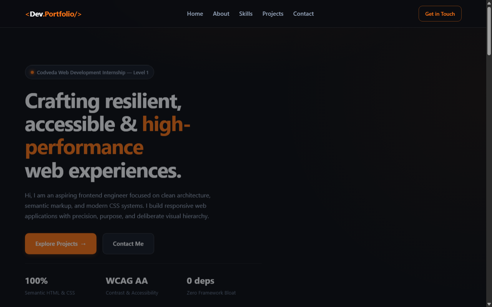
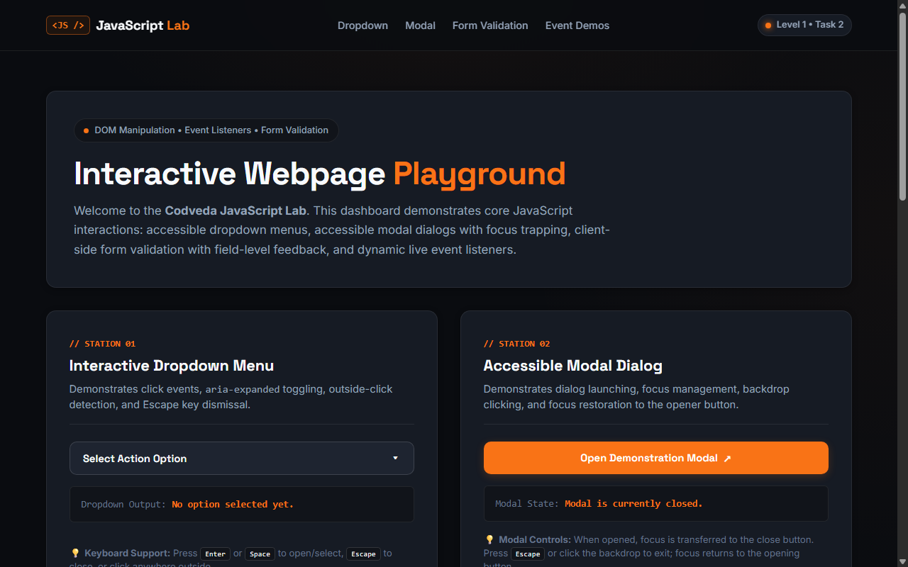

# Level 1 — Basic Web Development

> **Codveda Web Development Internship — Foundational Engineering Track**  
> Author: **Suvro Mahir Arman** ([@suvromahirarman-star](https://github.com/suvromahirarman-star))  
> Technologies: **Semantic HTML5, Modern CSS3, Vanilla JavaScript (ES6+), Zero Frameworks**

---

## 🧭 Level Overview

Level 1 establishes foundational software engineering principles for modern web applications. The focus is on clean architectural semantics, accessibility (a11y), responsive layouts without utility abstractions, event-driven client-side interactivity, and defensive input validation.

### Core Competencies Mastered
- **Semantic HTML5 Architecture:** Proper usage of landmarks (`<header>`, `<nav>`, `<main>`, `<section>`, `<article>`, `<aside>`, `<footer>`) ensuring search engine optimization (SEO) and screen reader navigability.
- **CSS3 Design Tokens & Styling:** Modular CSS custom properties (`:root` variables), responsive typography with `clamp()`, modern color systems, CSS Grid asymmetric layouts, and Flexbox alignments.
- **Pure DOM Manipulation (ES6+):** Vanilla JavaScript event listeners (`click`, `input`, `keydown`), keyboard navigation traps, accessible ARIA attributes, and stateful UI mutations without third-party frameworks.
- **Form Handling & Validation:** Intercepting submission cycles, validating field patterns, providing accessible live feedback with `aria-live` regions, and preventing invalid states.

---

## 📂 Projects Catalog

| Project | Domain | Primary Technologies | Key Deliverables | Direct Link |
| :--- | :--- | :--- | :--- | :--- |
| **01. Portfolio Webpage** | Personal Developer Identity | Semantic HTML5, CSS3 Grid/Flexbox | Single-page layout, sticky navigation, project showcase, contact channels, fluid typography | [`Portfolio-Webpage/`](./Portfolio-Webpage/) |
| **02. JavaScript Interactivity** | Interactive Web Application | Pure Vanilla JavaScript, DOM API | Dropdown menu, focus-trapped modal dialog, real-time validated form, live counters | [`JavaScript-Interactivity/`](./JavaScript-Interactivity/) |

---

## 📸 Visual Previews

### 01. Portfolio Webpage


### 02. JavaScript Interactivity


---

## 🚀 Execution & Verification

Both Level 1 projects are pure static frontend applications requiring zero compile steps or package installations.

### Running with Any Static Server / Browser:
```bash
# Option A: Open directly in your default browser
start Level-1-Basic/Portfolio-Webpage/index.html
start Level-1-Basic/JavaScript-Interactivity/index.html

# Option B: Run using a lightweight HTTP server (e.g., Python or Node serve)
npx serve Level-1-Basic/Portfolio-Webpage
npx serve Level-1-Basic/JavaScript-Interactivity
```

---

## 📑 Detailed Project Documentation
For individual requirements, architecture details, and implementation breakdown, visit:
- [Portfolio Webpage Documentation](./Portfolio-Webpage/README.md)
- [JavaScript Interactivity Documentation](./JavaScript-Interactivity/README.md)
