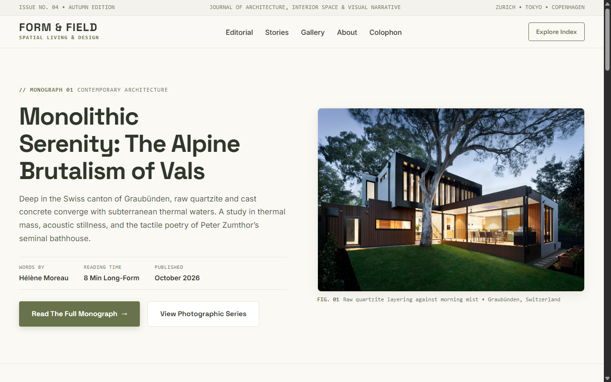
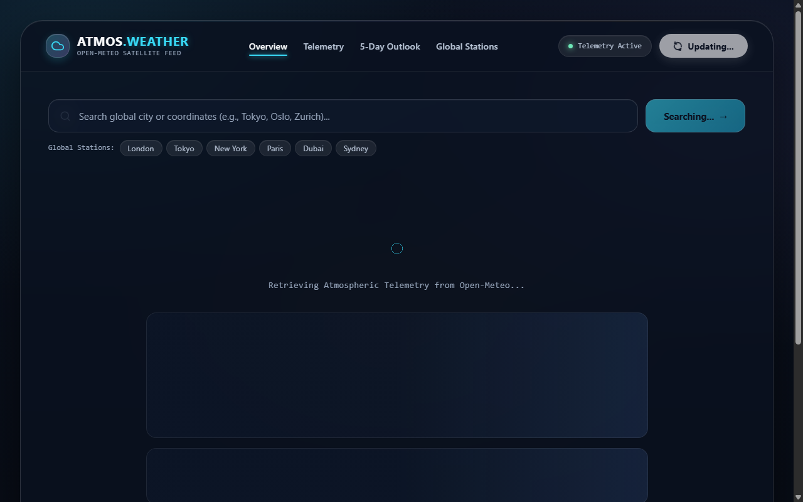

# Level 2 — Intermediate Web Applications

> **Codveda Web Development Internship — Advanced Frontend & Modern Frameworks Track**  
> Author: **Suvro Mahir Arman** ([@suvromahiarman-star](https://github.com/suvromahiarman-star))  
> Technologies: **Modern CSS Grid & Flexbox, React 18, Vite, Open-Meteo REST API, Modern Glassmorphism**

---

## 🧭 Level Overview

Level 2 bridges foundational web engineering into production-caliber frontend development. It explores two major frontend paradigms:
1. **Modern CSS Architecture:** Constructing complex responsive editorial layouts purely with CSS Flexbox and CSS Grid, maintaining responsiveness across mobile, tablet, desktop, and ultra-wide displays without JavaScript overhead.
2. **Component-Driven Frameworks (React 18):** Developing scalable, reactive single-page applications using modern React functional components, hooks (`useState`, `useEffect`, `useMemo`, `useCallback`), asynchronous REST API integration, and high-performance Vite tooling.

### Core Competencies Mastered
- **Two-Dimensional Grid & One-Dimensional Flexbox:** Combining CSS Flexbox for navigation bars and card alignments with CSS Grid for asymmetric magazine layouts and editorial galleries.
- **React 18 Component Architecture:** Atomic component decomposition, state lifting, controlled UI inputs, and defensive error boundaries.
- **RESTful API Consumption:** Asynchronous data orchestration, geolocation queries, loading and error states, and real-time metric transformation.
- **Modern Glassmorphic UI:** Multi-layered blurred backdrops, glowing atmospheric gradients, subtle border reflections, and micro-interactions.

---

## 📂 Projects Catalog

| Project | Domain | Primary Technologies | Key Deliverables | Direct Link |
| :--- | :--- | :--- | :--- | :--- |
| **01. Responsive Flexbox & Grid** | Editorial Digital Publication (*FORM & FIELD*) | HTML5, CSS3 Custom Properties, CSS Grid, CSS Flexbox | Fully responsive magazine layout, multi-column articles, asymmetric gallery, mobile-first drawer | [`Responsive-Flexbox-Grid/`](./Responsive-Flexbox-Grid/) |
| **02. React Weather Dashboard** | Atmospheric Telemetry Dashboard (*Atmos Weather*) | React 18, Vite, Open-Meteo API, Glassmorphism | Live geocoding search, hourly & 5-day forecasts, atmospheric metric cards, dynamic theme states | [`React-Weather-Dashboard/`](./React-Weather-Dashboard/) |

---

## 📸 Visual Previews

### 01. Responsive Flexbox & Grid (FORM & FIELD)


### 02. React Weather Dashboard (Atmos Weather)


---

## 🚀 Execution & Verification

### Project 1: Responsive Flexbox & Grid
Zero runtime dependencies or compilation required.
```bash
start Level-2-Intermediate/Responsive-Flexbox-Grid/index.html
```

### Project 2: React Weather Dashboard
Built with Vite and React 18.
```bash
cd Level-2-Intermediate/React-Weather-Dashboard
npm install
npm run dev
# The dashboard opens at http://localhost:5173
```

To create an optimized production build:
```bash
npm run build
npm run preview
```

---

## 📑 Detailed Project Documentation
For individual requirements, architecture details, and implementation breakdown, visit:
- [Responsive Flexbox & Grid Documentation](./Responsive-Flexbox-Grid/README.md)
- [React Weather Dashboard Documentation](./React-Weather-Dashboard/README.md)
