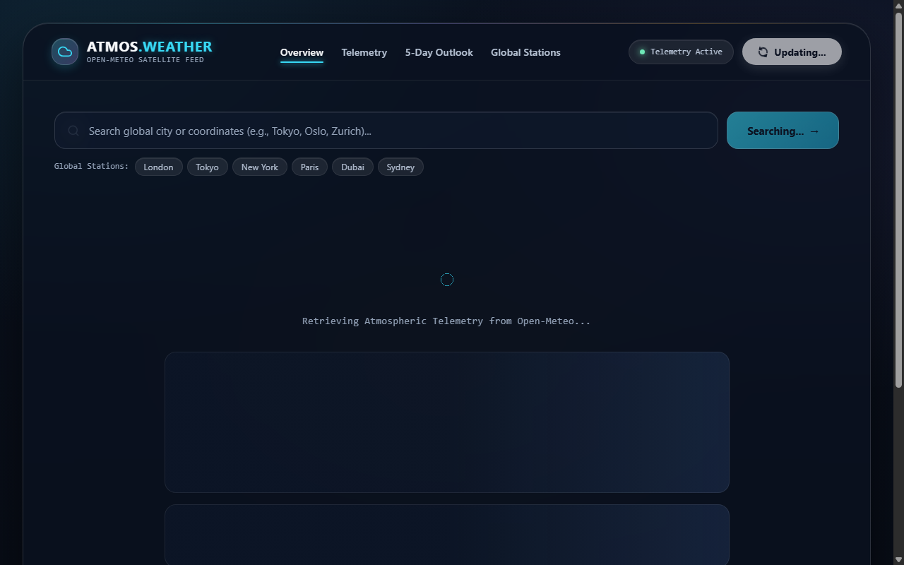

# Atmos Weather — Reference-Inspired Premium React Dashboard

> **Codveda Web Development Internship — Level 2, Task 2: Introduction to Front-End Frameworks (React)**  
> Built by: **Suvro Mahir Arman** | Date: October 2026 | Technology: **React 18 + Vite + Modern Glassmorphism**

---

## 📸 Visual Preview



---

## 🌤️ 1. Project Overview & Visual Direction

**Atmos Weather** is a modern, responsive, component-based meteorological application built with **React 18** and bundled using **Vite**. It queries live, free meteorological data from the **Open-Meteo Weather and Geocoding APIs** (no API keys required) to deliver real-time atmospheric measurements and an extended 5-day weather outlook.

The user interface is an original design directly inspired by the uploaded visual reference (**WoodNest Luxury Retreat Interface**), translating its signature aesthetics into a high-end weather telemetry product:
- **Framed Outer Window Canvas:** An enclosing rounded glass frame (`border: 1.5px solid rgba(255, 255, 255, 0.14)`, `border-radius: 36px`, `backdrop-filter: blur(28px)`) floating over a moody, misty mountain and pine atmosphere.
- **Top Navigation Bar:** Left-aligned branding, spacious centered navigation links, active telemetry badge, and a high-contrast white rounded pill action button (`btn-header-action`).
- **Dual-Column Hero Section (Focal Point):**
  - **Left:** Monumental three-tier editorial typography (*Line 1:* Solid white active city; *Line 2:* Frosted translucent condition/temperature at `rgba(248, 250, 252, 0.45)`; *Line 3:* Solid white country/region), contextual subtitle paragraph, and the trust/rating telemetry badge (**★ 4.9** &bull; *from 1,800+ stations worldwide*).
  - **Right:** The signature **floating translucent glass telemetry card** (mirroring the reference's booking card) with location title, dual date/wind selection pills, dual humidity/feels-like sub-cards, large temperature stat, and a full-width white pill action button.
- **Weather Details & 5-Day Outlook:** 4 translucent parameter cards and 5 daily forecast cards with aligned high/low bounds.

---

## 🎯 2. Codveda Task Objectives

| Official Requirement | Implementation in Atmos Weather | Status |
| :--- | :--- | :---: |
| **Set up a project using a front-end framework** | Scaffolds React 18 with Vite, fast HMR, and production-ready bundle output (`npm run build`). | ✅ Satisfied |
| **Understand components, props, and state management** | Breaks UI into 9 focused components; utilizes unidirectional props down and event callbacks up; manages UI/data state via `useState`. | ✅ Satisfied |
| **Create a simple component-based application** | Connects live geocoding and forecast queries, displaying real-time metrics, a 5-day daily forecast, quick city presets, and robust error/loading handling. | ✅ Satisfied |

---

## 🧩 3. Key React Concepts Demonstrated

### A. Component-Based Architecture
The interface is decoupled into single-responsibility components:
- `App.jsx`: Root orchestration component coordinating API calls, managing top-level application state, and providing the framed canvas container.
- `Header.jsx`: Top navigation showing branding, section links, telemetry badge, and manual data refresh button.
- `SearchBar.jsx`: Search input box with clear button and quick-select city preset chips (`London`, `Tokyo`, `New York`, `Paris`, `Dubai`, `Sydney`).
- `CurrentWeather.jsx`: The dual-column hero layout with monumental editorial typography on the left and the floating glass telemetry card on the right.
- `WeatherDetails.jsx`: 4-metric grid showcasing humidity, wind speed, apparent feels-like temperature, and precipitation.
- `ForecastList.jsx` & `ForecastCard.jsx`: 5-day daily forecast strip rendered efficiently using `.map()` with unique keys.
- `WeatherIcon.jsx`: Scalable inline SVG icon system rendering tailored weather iconography based on WMO weather codes.
- `LoadingState.jsx`: Accessible loading indicator with an atmospheric radar animation and content skeletons.
- `ErrorState.jsx`: User-friendly alert banner with an actionable "Retry Search" recovery button.

### B. Props (Unidirectional Data Flow)
- Data moves **down** from the parent `App` component into child components (e.g., passing `currentWeather` and `location` into `CurrentWeather`, or `forecast` array into `ForecastList`).
- Event handlers move **up** via callback props (e.g., `SearchBar` invokes `onSearch(cityQuery)` to trigger geocoding in `App`).

### C. State Management (`useState`)
Application state is kept clean, predictable, and local using React's `useState` hook:
- `location`: Stores resolved geocoding metadata (city name, country, admin region, coordinates, timezone).
- `currentWeather`: Stores real-time meteorological metrics (temperature, humidity, wind speed, apparent temp, rain, WMO code).
- `forecast`: Stores 5 daily outlook objects.
- `loading`: Boolean controlling loading spinners and skeleton screens.
- `error`: Stores user-friendly error messages when network calls fail or cities cannot be found.
- `activeCity`: Tracks the currently selected city for quick re-fetching and refresh actions.

### D. Side Effects (`useEffect`) & Async Operations
- Initial data loading is managed inside a `useEffect` hook with an empty dependency array `[]`, ensuring the dashboard loads default weather (`London`) automatically when the user first opens the page.
- Asynchronous API calls use native `fetch()` wrapped in a clean, decoupled service module (`weatherApi.js`).
- Stale responses and race conditions are prevented using a `useRef` request tracking counter (`latestRequestId`).

---

## 📁 4. Project Directory Structure

```text
React-Weather-Dashboard/
├── index.html                     # HTML5 entry point with Google Fonts (Space Grotesk & Inter)
├── package.json                   # Dependencies & scripts (React 18, Vite 6)
├── vite.config.js                 # Vite bundler configuration
├── public/
│   └── favicon.svg                # Custom atmospheric SVG favicon
├── src/
│   ├── main.jsx                   # React DOM root render entry point
│   ├── App.jsx                    # Root state coordinator and framed canvas container
│   ├── styles.css                 # Reference-based glassmorphism stylesheet & responsive system
│   ├── components/
│   │   ├── Header.jsx             # Top bar with branding, nav links & white action pill
│   │   ├── SearchBar.jsx          # Controlled search input & quick city presets
│   │   ├── CurrentWeather.jsx     # Dual-column hero: editorial title & floating glass card
│   │   ├── WeatherDetails.jsx     # Atmospheric metrics grid (4 cards)
│   │   ├── ForecastList.jsx       # 5-day forecast container
│   │   ├── ForecastCard.jsx       # Daily forecast card item
│   │   ├── WeatherIcon.jsx        # Scalable inline SVG weather icons
│   │   ├── LoadingState.jsx       # Skeleton & radar loading UI
│   │   └── ErrorState.jsx         # Graceful error banner with retry
│   ├── services/
│   │   └── weatherApi.js          # Open-Meteo Geocoding & Forecast API client
│   └── utils/
│       └── weatherHelpers.js      # WMO condition code mappings & date formatters
└── dist/                          # Production build output (generated via npm run build)
```

---

## 🎨 5. Color System & Glass Tokens

The design uses the exact palette specified in the prompt:

```css
:root {
  --color-background: #0B1220;         /* Midnight Navy base */
  --color-canvas-deep: #111C30;        /* Deep Navy tone */
  --color-surface-glass: rgba(255, 255, 255, 0.08); /* Primary glass surface */
  --color-surface-dark: rgba(17, 28, 48, 0.72);      /* Deep floating glass panel */
  --color-border-glass: rgba(255, 255, 255, 0.14);  /* Subtle frosted border */

  --color-primary: #38D9F5;            /* Electric Cyan highlight */
  --color-secondary: #9B8CFF;          /* Soft Violet atmospheric glow */
  --color-accent-warm: #F59E0B;        /* Warm amber glow (cabin-inspired accent) */
  --color-success: #6EE7B7;            /* Active telemetry indicator */
  --color-error: #FDA4AF;              /* Error alert tint */

  --color-text-primary: #F8FAFC;       /* Crisp white headings & key numbers */
  --color-text-secondary: #B8C4D6;     /* Body & secondary descriptions */
  --color-text-frosted: rgba(248, 250, 252, 0.45); /* Signature frosted text */
  --color-text-muted: #94A3B8;         /* Micro-labels & captions */

  --glass-blur-heavy: blur(28px);
  --glass-highlight: inset 0 1px 0 rgba(255, 255, 255, 0.15);
  --frame-radius: 36px;
  --card-radius-lg: 26px;
}
```

---

## 🚀 6. Installation & Execution Guide

### Prerequisites
- Node.js (version 18 or newer recommended, tested with Node.js v24)
- npm (version 9 or newer)

### Step 1: Open Terminal in Project Directory
```powershell
cd "D:\Codveda Tech Intern\Level-2-Intermediate\React-Weather-Dashboard"
```

### Step 2: Install Dependencies
```powershell
npm install
```

### Step 3: Start Development Server
```powershell
npm run dev
```
Open your browser and navigate to the local URL displayed (typically `http://localhost:5173/`).

### Step 4: Build for Production
```powershell
npm run build
```
Generates optimized, minified production assets inside the `dist/` folder.

### Step 5: Preview Production Build
```powershell
npm run preview
```

---

## 🧪 7. Quality Assurance & Testing Matrix

| Test Scenario | Action Performed | Expected Result | Result |
| :--- | :--- | :--- | :---: |
| **Initial Mount** | App launches on `http://localhost:5173` | Fetches default city (London); displays framed window, editorial hero, floating glass card, 4 detail metrics, and 5-day outlook. | ✅ Passed |
| **Valid City Search** | Searched "Tokyo", "Dhaka", "Paris" | Geocoding resolves coordinates; cards animate in with new data and updated city name. | ✅ Passed |
| **Empty Input Validation** | Clicked "Search" with empty input | Input highlights in cyan; displays helpful prompt asking user to enter a city name. | ✅ Passed |
| **Unknown City Error** | Searched "Nonexistentplace12345" | Displays friendly error state ("City not found...") with a working "Retry Search" button. | ✅ Passed |
| **Preset Chips** | Clicked quick preset buttons | Triggers immediate query for clicked preset without requiring manual typing. | ✅ Passed |
| **Refresh Button** | Clicked header refresh button | Shows loading spinner, re-fetches latest live data for active city, and updates UI. | ✅ Passed |
| **Mobile Layout (375px)** | Simulated iPhone / small mobile screen | Framed canvas adapts gracefully; editorial title and floating card stack vertically; no horizontal scroll. | ✅ Passed |
| **Tablet Layout (768px)** | Simulated iPad / tablet screen | 2-column details grid; nav links collapse cleanly; touch targets are $\ge 44\text{px}$. | ✅ Passed |
| **Desktop Layout (1024px+)** | Tested widescreen display | Dual-column split hero; 4-column details grid; 5-day horizontal forecast strip; framed window centered. | ✅ Passed |
| **Production Build** | Executed `npm run build` | 0 syntax errors, 0 linter errors, compiled in 1.97s into `dist/`. | ✅ Passed |

---

## 🌐 8. Attribution & APIs Used

- **Weather Forecast Data:** [Open-Meteo Weather Forecast API](https://open-meteo.com/) (Open database license, free non-commercial and commercial use without API key).
- **Geocoding Data:** [Open-Meteo Geocoding API](https://open-meteo.com/en/docs/geocoding-api) (Worldwide geographic coordinates resolution).
- **Typography:** [Google Fonts](https://fonts.google.com/) (`Space Grotesk` & `Inter`).
