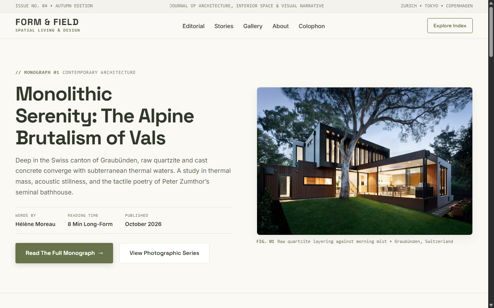

# FORM & FIELD — Design, Places & Visual Stories

**Track:** Level 2 — Intermediate Web Applications  
**Task:** Task 1 — Responsive Web Design with Flexbox and Grid  
**Author:** Suvro Mahir Arman ([@suvromahiarman-star](https://github.com/suvromahiarman-star))  
**Tech Stack:** Pure Semantic HTML5, Modern CSS3 (CSS Flexbox, CSS Grid, CSS Custom Properties &bull; Zero Frameworks &bull; Zero JavaScript)

---

## 📸 Visual Preview



---

## 📌 Project Overview

**FORM & FIELD** is an editorial digital publication dedicated to contemporary architecture, interior living, creative studios, and contemplative photography.

The project demonstrates production-grade responsive layout architecture combining **CSS Flexbox** (for one-dimensional directional flow, alignment, and space distribution) and **CSS Grid** (for two-dimensional coordinate layouts, multi-column card catalogs, and asymmetric gallery spanning). It runs natively in modern web browsers without JavaScript, frameworks, or external build dependencies.

---

## 🎨 Editorial Color Palette & Design Tokens

The visual identity is styled with a natural editorial aesthetic utilizing centralized CSS custom properties:

```css
:root {
  --color-background: #FAF9F4;      /* Warm white: main page background & light sections */
  --color-primary: #68734B;         /* Olive green: buttons, accents, labels */
  --color-heading: #303629;         /* Deep olive: headings, typography, dark footer */
  --color-surface: #FFFFFF;         /* Pure white: article card contrast surfaces */
  --color-muted: #E8E6D9;           /* Soft sage-beige: card surfaces, borders, dividers */
  --color-text: #303629;            /* Deep olive text */
  --color-border: #E8E6D9;          /* Soft sage-beige borders */
}
```

- **Visual Balance Distribution:** ~70% warm white & pure white, ~20% olive & deep olive, ~10% sage-beige supporting details.

---

## 🎯 Official Codveda Objectives & Fulfillment

| Official Codveda Requirement | Implementation Technique | Verification Status |
| :--- | :--- | :---: |
| **1. Use Flexbox for page layout and alignment** | Employed Flexbox across the Masthead, Header & Navigation, Editorial Hero section, Article metadata strips, About manifesto, and Colophon footer. | ✅ Pass |
| **2. Use CSS Grid for organizing sections (gallery or blog layout)** | Structured the 6-article featured collection with multi-column CSS Grid and engineered an asymmetric 6-photo gallery utilizing explicit `grid-column` and `grid-row` spans. | ✅ Pass |
| **3. Ensure the layout adapts to desktop, tablet, and mobile screens** | Implemented a mobile-first responsive strategy verified at 375px (mobile), 768px (tablet), and 1440px (desktop), ensuring zero horizontal overflow and natural element reflow. | ✅ Pass |

---

## 📐 Deep Dive: CSS Flexbox vs. CSS Grid

Understanding when to choose Flexbox versus Grid is a core frontend competency. Here is how both systems are demonstrated in this project:

```text
┌────────────────────────────────────────────────────────────────────────┐
│                        CSS FLEXBOX (1-DIMENSIONAL)                     │
│  Designed for either a ROW or a COLUMN at a time. Ideal for alignment, │
│  content distribution, headers, navigation, metadata strips, & footers.│
└────────────────────────────────────────────────────────────────────────┘
                                     vs.
┌────────────────────────────────────────────────────────────────────────┐
│                          CSS GRID (2-DIMENSIONAL)                      │
│  Designed for ROWS AND COLUMNS simultaneously. Ideal for multi-column  │
│  catalogs, card decks, and asymmetric photographic mosaic layouts.     │
└────────────────────────────────────────────────────────────────────────┘
```

### 1. Where Flexbox is Used (One-Dimensional Alignment)

| Component | Key Flexbox Properties | Why Flexbox Was Chosen |
| :--- | :--- | :--- |
| **Masthead & Nav Bar** | `display: flex; justify-content: space-between; align-items: center;` | Automatically distributes the brand wordmark to the left, navigation items in the center, and action CTA to the right along a single horizontal axis. |
| **Navigation List** | `display: flex; gap: clamp(1rem, 2vw, 2rem); align-items: center;` | Distributes links with uniform inline spacing without requiring legacy float or margin hacks. |
| **Editorial Hero** | `display: flex; flex-direction: row; gap: 4.5rem;` (desktop) &rarr; `flex-direction: column;` (mobile) | Couples the lead narrative column and architectural photograph side-by-side on desktop, seamlessly stacking on mobile. |
| **Metadata Strips** | `display: flex; gap: 2rem; flex-wrap: wrap;` | Keeps author, read time, and publication date aligned horizontally with automatic line wrapping on smaller viewports. |
| **About Manifesto** | `display: flex; flex-direction: row; gap: 5rem;` | Aligns the large editorial pull-quote alongside the narrative text columns, maintaining equal top alignment. |
| **Footer & Colophon** | `display: flex; justify-content: space-between; flex-wrap: wrap; gap: 3rem;` | Balances brand narrative and navigation columns horizontally across widescreen viewports, wrapping cleanly as space contracts. |

### 2. Where CSS Grid is Used (Two-Dimensional Layout)

| Component | Key Grid Properties | Why CSS Grid Was Chosen |
| :--- | :--- | :--- |
| **Featured Stories Section** | `display: grid; grid-template-columns: repeat(3, 1fr); gap: 2.5rem;` | Forms a rigid 3-column card deck on desktop, transitioning to 2 columns on tablet (`repeat(2, 1fr)`), and 1 column on mobile (`1fr`). Enforces uniform card widths across rows. |
| **Asymmetric Photo Gallery** | `display: grid; grid-template-columns: repeat(4, 1fr); grid-auto-rows: 250px; gap: 1.25rem;` | Controls both column tracks and row heights simultaneously, allowing selective items to span multiple cells: |
| &bull; *Gallery Item 1 (Hero Photo)* | `grid-column: span 2; grid-row: span 2;` | Dominates the top-left quadrant across 2 columns and 2 rows. |
| &bull; *Gallery Item 3 (Tall Lightwell)* | `grid-column: span 1; grid-row: span 2;` | Accentuates verticality by spanning 2 rows in height. |
| &bull; *Standard Gallery Items* | `grid-column: span 1; grid-row: span 1;` | Fill remaining coordinate slots to create visual rhythm. |

---

## 📱 Responsive Layout Strategy (Mobile-First)

The stylesheet uses a mobile-first foundation with progressive enhancements:

```text
┌─────────────────┐       ┌─────────────────┐       ┌─────────────────┐
│     MOBILE      │       │     TABLET      │       │     DESKTOP     │
│   (375px–640px) │ ───►  │  (768px–992px)  │ ───►  │  (1024px–1440px)│
│  Single Column  │       │    2 Columns    │       │ 3–4 Cols Multi  │
│  Stacked Layout │       │ Hero Stacked/Adj│       │ Asymmetric Grid │
└─────────────────┘       └─────────────────┘       └─────────────────┘
```

1. **Mobile (`<= 640px`):**
   - Stories collapse into a clean single-column feed (`grid-template-columns: 1fr`).
   - Gallery resets all spans to `grid-column: span 1; grid-row: auto; aspect-ratio: 16 / 10;`, preventing awkward vertical gaps or distorted ratios on small screens.
   - Masthead items stack or hide non-critical metadata; navigation scrolls horizontally without breaking page bounds.
2. **Tablet (`768px – 992px`):**
   - Stories reorganize into a 2-column grid (`grid-template-columns: repeat(2, 1fr)`).
   - Gallery adapts to 2 columns with reduced row heights (`grid-auto-rows: 220px`).
   - Hero and About sections maintain a single column stack with expanded readability margins.
3. **Desktop (`1024px – 1440px+`):**
   - Stories expand to the full 3-column layout.
   - Gallery renders the full 4-column asymmetric exhibition.
   - Container max width bounded at `1280px` with centered auto margins.

---

## 📂 Project Directory Structure

```text
Responsive-Flexbox-Grid/
├── index.html           # Semantic HTML5 document (All 6 core sections)
├── styles.css           # Complete CSS3 stylesheet (Design tokens, Flexbox & Grid systems)
├── README.md            # Comprehensive documentation, Grid vs. Flexbox analysis & testing checklist
└── assets/
    └── images/          # Curated high-resolution architectural & interior photography
        ├── hero.jpg     # Alpine concrete architecture in Vals
        ├── story-1.jpg  # Cast-concrete pavilion in Kyoto
        ├── story-2.jpg  # Scandinavian terracotta and oak interior
        ├── story-3.jpg  # Nordic coastal artist retreat in Lofoten
        ├── story-4.jpg  # Earth-cast desert dwelling in Atacama
        ├── story-5.jpg  # Traditional Japanese timber joinery
        ├── story-6.jpg  # Biophilic vertical sky-gardens
        ├── gallery-1.jpg# Curvilinear facade (span 2 cols, span 2 rows)
        ├── gallery-2.jpg# Clay pottery and linen sunlight
        ├── gallery-3.jpg# Helical concrete lightwell (span 2 rows)
        ├── gallery-4.jpg# Misty alpine mountain valley
        ├── gallery-5.jpg# Minimalist limestone fireplace living room
        └── gallery-6.jpg# Architectural window shadow lines
```

---

## 🚀 How to Run Locally

Because this project uses pure HTML5 and CSS3, it requires no build steps or server configurations:

### Option 1: Direct File Launch
Double-click `index.html` or open in PowerShell:
```powershell
Start-Process "D:\Codveda Tech Intern\Level-2-Intermediate\Responsive-Flexbox-Grid\index.html"
```

### Option 2: Local Test Server
```powershell
# From D:\Codveda Tech Intern\Level-2-Intermediate\Responsive-Flexbox-Grid\
python -m http.server 5000
```
Then visit `http://localhost:5000` in your web browser.

---

## 🎨 Image Sources & Licensing Attribution

All imagery used in this project is royalty-free photography sourced via [Unsplash](https://unsplash.com) under the Unsplash License (free for commercial and personal use):

- **Hero Image (`hero.jpg`):** Photo by Alexander van Steenberge (Unsplash).
- **Story 1 (`story-1.jpg`):** Photo by Jakhongir Ismoilov (Unsplash).
- **Story 2 (`story-2.jpg`):** Photo by Spacejoy (Unsplash).
- **Story 3 (`story-3.jpg`):** Photo by Francesca Tosolini (Unsplash).
- **Story 4 (`story-4.jpg`):** Photo by Luca Bravo (Unsplash).
- **Story 5 (`story-5.jpg`):** Photo by Su San Lee (Unsplash).
- **Story 6 (`story-6.jpg`):** Photo by Victor Garcia (Unsplash).
- **Gallery 1 (`gallery-1.jpg`):** Photo by Danist Soh (Unsplash).
- **Gallery 2 (`gallery-2.jpg`):** Photo by Annie Spratt (Unsplash).
- **Gallery 3 (`gallery-3.jpg`):** Photo by Ricardo Gomez Angel (Unsplash).
- **Gallery 4 (`gallery-4.jpg`):** Photo by Bailey Zindel (Unsplash).
- **Gallery 5 (`gallery-5.jpg`):** Photo by R Architecture (Unsplash).
- **Gallery 6 (`gallery-6.jpg`):** Photo by Nastuh Abootalebi (Unsplash).

---

## 🧪 Testing Checklist & Verification Results

| Test Parameter | Target Environment | Verification Detail | Result |
| :--- | :--- | :--- | :---: |
| **Mobile Viewport** | 375px (Viewport width) | Stories grid adapts to 1 column; gallery spans reset to natural aspect ratios; touch targets $\ge 44\text{px}$; 0 horizontal overflow. | ✅ Pass |
| **Tablet Viewport** | 768px (Viewport width) | Stories adapt to 2 columns; hero stacks cleanly; gallery adjusts to 2 columns without clipping. | ✅ Pass |
| **Desktop Viewport** | 1440px (Viewport width) | Full 3-column stories deck; 4-column asymmetric gallery with 2-span hero and 2-span tall images; max width $1280\text{px}$. | ✅ Pass |
| **Flexbox Validation** | All viewports | Header, masthead, hero content, card footers, about section, and colophon footer respond cleanly via Flexbox rules. | ✅ Pass |
| **CSS Grid Validation** | All viewports | Verified 2D coordinate placement, `repeat()`, `grid-column`, `grid-row`, and responsive media query reflow. | ✅ Pass |
| **Keyboard Accessibility** | Desktop keyboard | Skip link activates on initial Tab; `:focus-visible` rings render in olive green; semantic heading hierarchy ($h1 \rightarrow h2 \rightarrow h3 \rightarrow h4$). | ✅ Pass |
| **Reduced Motion** | `prefers-reduced-motion` | Tested zero-duration animations and disabled hover zooms (`transform: none`). | ✅ Pass |
| **Asset Integrity** | Local disk check | All 13 local images load with valid HTTP status and non-zero byte lengths. | ✅ Pass |
| **Zero JS / Frameworks**| Project scope | Pure HTML5 & CSS3 verified. Zero scripts or third-party CSS bundles. | ✅ Pass |

---

## 🎥 Video Demonstration Checklist (For Internship Evaluation)

When recording your video walkthrough or presenting to an evaluator:

1. **Introduction & Flexbox Walkthrough:**
   - Highlight the masthead and navigation bar, pointing out how `display: flex; justify-content: space-between;` creates horizontal balance.
   - Show the hero section on desktop, explaining that `display: flex; flex-direction: row;` pairs the story excerpt with the lead image.
2. **CSS Grid Walkthrough:**
   - Scroll to **Curated Stories**, explaining `grid-template-columns: repeat(3, 1fr);` and how `gap: 2.5rem;` manages spacing without margin calculations.
   - Scroll to **Asymmetric Gallery**, pointing out the 4-column coordinate grid and demonstrating how Item 1 spans 2 columns and 2 rows (`grid-column: span 2; grid-row: span 2;`).
3. **Responsive Demonstration (DevTools `F12`):**
   - Resize to **Tablet (768px)**: Show how Stories adapt to 2 columns and the Gallery adapts to 2 columns.
   - Resize to **Mobile (375px)**: Show that Stories stack to 1 column, Gallery spans reset smoothly, and the page produces zero horizontal scrolling.
4. **Accessibility & Standards:**
   - Tab through the page to demonstrate the visible focus rings and skip-to-content link.

