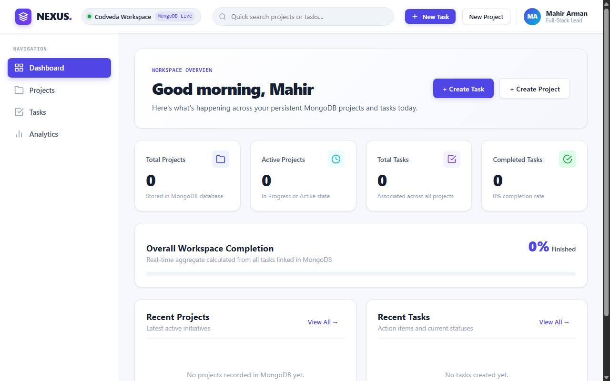
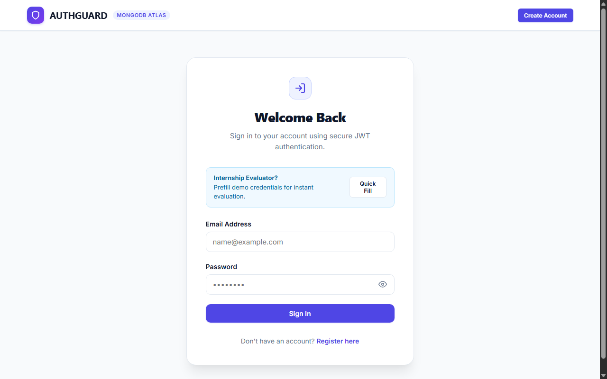

# Level 3 — Advanced Full-Stack Systems

> **Codveda Web Development Internship — Enterprise Architecture & Security Track**  
> Author: **Suvro Mahir Arman** ([@suvromahirarman-star](https://github.com/suvromahirarman-star))  
> Technologies: **MERN Stack (MongoDB Atlas, Express.js, React 18, Node.js), JWT, bcryptjs, Jest, Supertest**

---

## 🧭 Level Overview

Level 3 represents the pinnacle of the internship program, focusing on production-grade, enterprise-ready full-stack applications. Both projects implement decoupled client-server architectures, persistent cloud databases via MongoDB Atlas, rigorous security hardening, cryptographically secure authentication, and automated integration test suites.

### Core Competencies Mastered
- **Full-Stack MERN Architecture:** Decoupled Express.js REST backends serving reactive React 18 SPAs, managed through centralized root lifecycle npm scripts.
- **Cloud Database Modeling & Mongoose:** Strict schema definitions, timestamp indexing, lifecycle hooks, cascading deletions, and optimistic concurrency.
- **Enterprise Security Hardening:**
  - **Regex ReDoS Protection:** Escaping all regex metacharacters in search queries to eliminate catastrophic backtracking vulnerabilities.
  - **Dual-Tier Rate Limiting:** Separate general API limiters and high-protection mutation limiters preventing brute-force and resource exhaustion.
  - **Strict Request Body Caps:** 500KB JSON limits guarding against denial-of-service memory exhaustion.
  - **Cryptographic Authentication:** `bcryptjs` salted hashing (10 rounds) and stateless JSON Web Tokens (`HS256`) with token version invalidation.
- **Automated Testing & QA:** Dedicated isolated test database setups (`nexus_test`), Jest test runners, and Supertest integration suites validating API contracts.

---

## 📂 Projects Catalog

| Project | Domain | Tech Stack | Architectural Highlights | Direct Link |
| :--- | :--- | :--- | :--- | :--- |
| **01. NEXUS Project Manager** | SaaS Project & Task Management | React 18, Express, MongoDB Atlas, Mongoose, Jest | Full CRUD for projects and tasks, priority & lifecycle filters, ReDoS security fix, rate limiting, automated Jest/Supertest suite | [`NEXUS-Project-Manager/`](./NEXUS-Project-Manager/) |
| **02. User Authentication System** | Enterprise Identity & Access Management | React 18, Express, MongoDB Atlas, bcrypt, JWT | Secure user registration, password hashing, JWT sessions, token version invalidation, role-based access control, profile updates | [`User-Authentication-System/`](./User-Authentication-System/) |

---

## 📸 Visual Previews

### 01. NEXUS Project Manager


### 02. User Authentication System (AuthGuard)


---

## 🛡️ Security & Environment Configuration

Both Level 3 applications strictly enforce credential isolation. Real environment files (`.env`) are excluded from version control. Safe templates (`.env.example`) are provided in both root and server directories.

### Setup Steps for Each Project:
1. Copy `.env.example` to `.env` in the server directory:
   ```bash
   cd Level-3-Advanced/NEXUS-Project-Manager/server
   cp .env.example .env
   ```
2. Configure your MongoDB Atlas connection string in `.env`:
   ```env
   PORT=5000
   MONGODB_URI=mongodb+srv://<username>:<password>@cluster0.mongodb.net/your_db?retryWrites=true&w=majority
   CLIENT_URL=http://localhost:5173
   ```
3. Repeat similarly for `User-Authentication-System`.

---

## 🚀 Execution & Verification

Each Level 3 project provides orchestrated root scripts for seamless development and testing.

### NEXUS Project Manager
```bash
cd Level-3-Advanced/NEXUS-Project-Manager

# Install dependencies for both server and client
npm run install:all

# Run backend and frontend concurrently
npm run dev:server    # Runs on http://localhost:5000
npm run dev:client    # Runs on http://localhost:5173

# Execute automated test suite (requires MONGODB_URI_TEST set to nexus_test)
npm test
```

### User Authentication System
```bash
cd Level-3-Advanced/User-Authentication-System

# Install dependencies for both server and client
npm run install:all

# Run backend and frontend
npm run dev:server    # Express API on http://localhost:5000
npm run dev:client    # React client on http://localhost:5173
```

---

## 📑 Detailed Project Documentation
For comprehensive deep dives into schema designs, API endpoints, test suites, and audit logs, visit:
- [NEXUS Project Manager Documentation](./NEXUS-Project-Manager/README.md)
- [User Authentication System Documentation](./User-Authentication-System/README.md)
