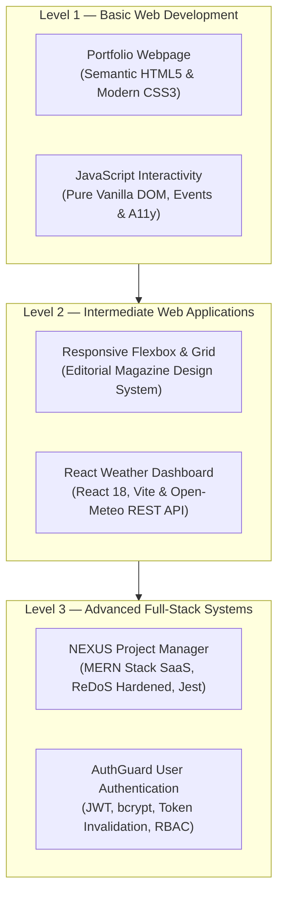
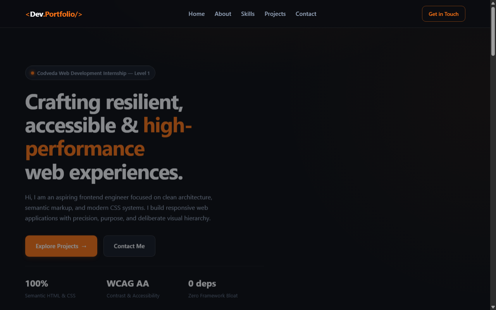
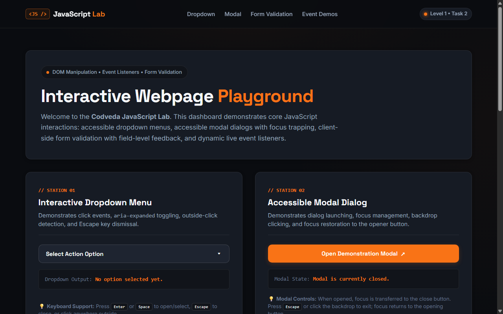
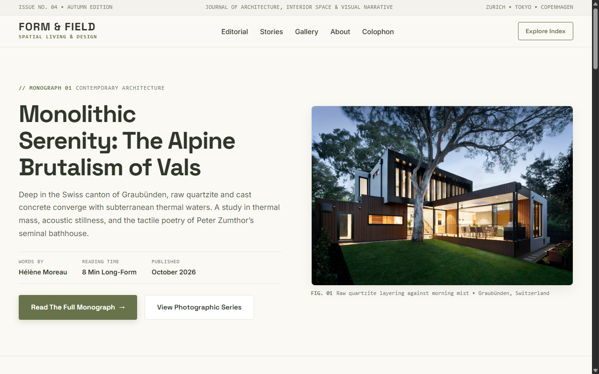
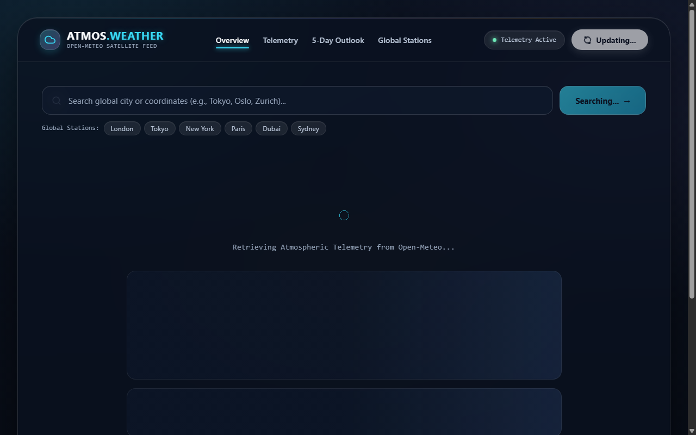
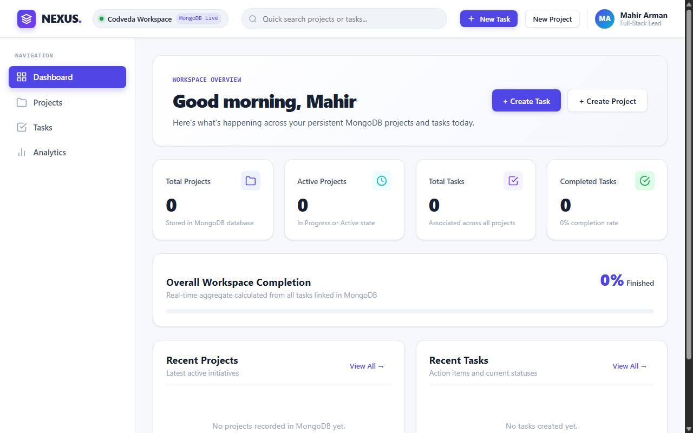
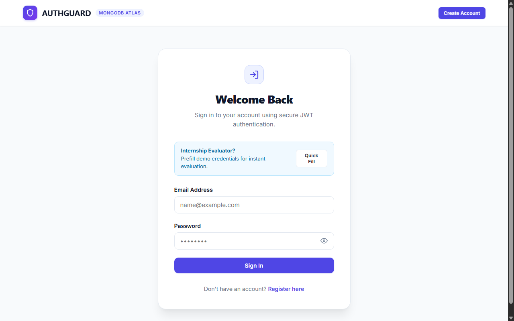

# 🚀 Codveda Web Development Internship — Monorepo Portfolio

[](https://github.com/suvromahiarman-star)
[](https://github.com/suvromahiarman-star)
[](https://github.com/suvromahiarman-star)
[](https://github.com/suvromahiarman-star)
[](./LICENSE)

[](https://react.dev/)
[](https://nodejs.org/)
[](https://expressjs.com/)
[](https://www.mongodb.com/atlas)
[](https://vitejs.dev/)
[](https://jestjs.io/)

---

## 📖 Executive Summary

Welcome to the official monorepo repository containing all six production-grade web development projects completed by **Suvro Mahir Arman** during the **Codveda Web Development Internship**. 

This repository demonstrates a complete journey from core web fundamentals to scalable cloud architectures. Each project was built with production rigor, adhering to modern software engineering best practices, semantic accessibility, responsive design systems, cryptographic security standards, and automated testing suites.

---

## 🧭 Progressive Architecture Roadmap

The monorepo is organized into three progressive, escalating engineering tiers:



---

## 📊 Comprehensive Project Matrix & Visual Gallery

| Level & Task | Project Name | Domain / Stack | Key Capabilities & Highlights | Visual Preview | Documentation |
| :--- | :--- | :--- | :--- | :---: | :---: |
| **Level 1<br/>Task 1** | **[Portfolio Webpage](./Level-1-Basic/Portfolio-Webpage/)** | Personal Portfolio<br/>`HTML5` `CSS3` | Semantic landmarks, responsive layout, fluid clamp typography, accessible contrast, zero dependencies | [](./screenshots/level-1/portfolio-webpage.png) | [README](./Level-1-Basic/Portfolio-Webpage/README.md) |
| **Level 1<br/>Task 2** | **[JavaScript Interactivity](./Level-1-Basic/JavaScript-Interactivity/)** | Interactive Playground<br/>`Vanilla JS` `DOM API` | Custom dropdown menu, focus-trapped modal dialog, client-side form validation, live counters | [](./screenshots/level-1/javascript-interactivity.png) | [README](./Level-1-Basic/JavaScript-Interactivity/README.md) |
| **Level 2<br/>Task 1** | **[Responsive Flexbox & Grid](./Level-2-Intermediate/Responsive-Flexbox-Grid/)** | Editorial Publication (*FORM & FIELD*)<br/>`CSS Flexbox` `CSS Grid` | Two-dimensional coordinate grid, asymmetric gallery layout, 1D flexbox navigation, zero JavaScript | [](./screenshots/level-2/responsive-flexbox-grid.png) | [README](./Level-2-Intermediate/Responsive-Flexbox-Grid/README.md) |
| **Level 2<br/>Task 2** | **[React Weather Dashboard](./Level-2-Intermediate/React-Weather-Dashboard/)** | Atmospheric Telemetry (*Atmos Weather*)<br/>`React 18` `Vite` `Open-Meteo` | Live geocoding search, hourly & 5-day forecasts, glassmorphic UI, dynamic weather icons, error boundaries | [](./screenshots/level-2/react-weather-dashboard.png) | [README](./Level-2-Intermediate/React-Weather-Dashboard/README.md) |
| **Level 3<br/>Task 1** | **[NEXUS Project Manager](./Level-3-Advanced/NEXUS-Project-Manager/)** | SaaS Project Management<br/>`React 18` `Express` `MongoDB` `Jest` | Full Project/Task CRUD, automated progress aggregation, ReDoS security fix, dual rate limiting, Jest test suite | [](./screenshots/level-3/nexus-project-manager.png) | [README](./Level-3-Advanced/NEXUS-Project-Manager/README.md) |
| **Level 3<br/>Task 2** | **[User Authentication System](./Level-3-Advanced/User-Authentication-System/)** | Identity Management (*AuthGuard*)<br/>`React 18` `Express` `JWT` `bcrypt` | Secure registration & login, password hashing, JWT stateless sessions, token version invalidation, RBAC | [](./screenshots/level-3/user-authentication-system.png) | [README](./Level-3-Advanced/User-Authentication-System/README.md) |

---

## 🔍 Detailed Tier-by-Tier Breakdown

### 🟢 Level 1 — Basic Web Development
- **Focus:** Semantic structure, accessible markup, modern layout techniques, and pure client-side event loops.
- **[Portfolio Webpage](./Level-1-Basic/Portfolio-Webpage/):**
  - Modern single-page portfolio featuring an introduction hero, about section, technical skill badges, curated project cards, and direct contact avenues.
  - Zero third-party frameworks, built purely with semantic HTML5 (`<main>`, `<section>`, `<article>`, `<nav>`) and modern CSS3 (Custom properties, Flexbox, Grid).
- **[JavaScript Interactivity](./Level-1-Basic/JavaScript-Interactivity/):**
  - Four interactive stations showcasing foundational DOM programming:
    1. *Accessible Dropdown Menu* with outside-click detection and keyboard Escape dismissal.
    2. *Focus-Trapped Modal Dialog* retaining keyboard tab navigation inside the dialog overlay.
    3. *Client-Side Form Validation* with live error feedback, `e.preventDefault()` interception, and ARIA live regions.
    4. *Live Event Counters* demonstrating real-time textarea character limits and numerical state tracking.

### 🟡 Level 2 — Intermediate Web Applications
- **Focus:** Complex responsive layout engineering and reactive single-page front-end frameworks.
- **[Responsive Flexbox & Grid (FORM & FIELD)](./Level-2-Intermediate/Responsive-Flexbox-Grid/):**
  - High-end digital editorial magazine exploring contemporary architecture and visual arts.
  - Showcases the synergy between **CSS Flexbox** (1D header navigation, author meta badges, button alignments) and **CSS Grid** (2D editorial catalog, asymmetric photo essays, full-width feature cards).
- **[React Weather Dashboard (Atmos Weather)](./Level-2-Intermediate/React-Weather-Dashboard/):**
  - Atmospheric telemetry application built with **React 18** and **Vite**.
  - Integrated with the **Open-Meteo REST API** for live global geocoding, current weather conditions, and 5-day forecasts.
  - Styled with a dark glassmorphism design system featuring blurred backdrops (`backdrop-filter`), glowing environmental gradients, and custom telemetry stat widgets.

### 🔴 Level 3 — Advanced Full-Stack Systems
- **Focus:** Production-grade client-server decoupling, persistent cloud databases, cryptographic authentication, defensive security hardening, and automated QA.
- **[NEXUS Project Manager](./Level-3-Advanced/NEXUS-Project-Manager/):**
  - Enterprise SaaS application for multi-project planning and task lifecycle tracking.
  - Decoupled architecture: React 18 SPA frontend communicating with an Express.js REST API backed by MongoDB Atlas.
  - Real-time progress metric calculations automatically aggregated on the database tier.
  - Hardened against **MongoDB Regex ReDoS** via character escaping and strict query constraints.
  - Dual-tier rate limiting (general API limit + mutation limit) and 500KB JSON body caps.
  - Verified with an automated **Jest + Supertest** integration test suite connected to a dedicated test database (`nexus_test`).
- **[User Authentication System (AuthGuard)](./Level-3-Advanced/User-Authentication-System/):**
  - Robust identity and access management system with complete authentication lifecycle.
  - Features user registration, login, profile management, and role-based access control (`user` and `admin`).
  - Cryptographically secure password hashing using **bcryptjs** (10 salt rounds).
  - Stateless authentication via **JSON Web Tokens (JWT)** with **tokenVersion invalidation**, enabling instantaneous logout and cross-device session termination.

---

## 🛡️ Enterprise Security & Hardening Highlights

During the advanced engineering phases and comprehensive industry audits, significant security and reliability hardening was implemented across the full-stack applications:

1. **Catastrophic Backtracking (ReDoS) Defense:**
   - In NEXUS search queries, user input is strictly sanitized with `escapeRegex` before building MongoDB query objects, preventing denial-of-service regex payloads.
2. **Dual-Tier Rate Limiting:**
   - Express backends enforce general API rate limits (300 requests / 15 minutes) alongside stricter mutation rate limits (60 requests / 15 minutes) to neutralize brute-force attacks.
3. **Request Body-Size Hardening:**
   - Express JSON parsers enforce a strict 500KB payload limit, rejecting oversized malicious payloads with HTTP 413 (*Payload Too Large*).
4. **Credential Isolation & Zero-Secret Policy:**
   - All production MongoDB URIs, JWT secrets, and connection credentials are strictly excluded via `.gitignore`.
   - Pre-configured, safe `.env.example` templates guide environment setup without leaking sensitive information.
5. **Database Test Isolation:**
   - Automated test runners enforce a strict test database barrier (`nexus_test`), refusing to execute against production databases or ambiguous URIs.

---

## 📁 Repository Structure

```
Codveda-Web-Development-Internship/
├── .gitignore                          # Global git exclusion rules (secrets, dist, node_modules)
├── LICENSE                             # MIT Open-Source License
├── README.md                           # Master Monorepo Documentation (this file)
│
├── Level-1-Basic/                      # Foundational Web Development
│   ├── README.md                       # Level 1 Overview & Running Instructions
│   ├── Portfolio-Webpage/              # Task 1: Semantic Single-Page Developer Portfolio
│   │   ├── index.html
│   │   ├── styles.css
│   │   └── README.md
│   └── JavaScript-Interactivity/       # Task 2: Pure Vanilla JS Interactive Playground
│       ├── index.html
│       ├── styles.css
│       ├── script.js
│       └── README.md
│
├── Level-2-Intermediate/               # Responsive Design & Modern Frontend Frameworks
│   ├── README.md                       # Level 2 Overview & Running Instructions
│   ├── Responsive-Flexbox-Grid/        # Task 1: Editorial Publication (FORM & FIELD)
│   │   ├── assets/
│   │   ├── index.html
│   │   ├── styles.css
│   │   └── README.md
│   └── React-Weather-Dashboard/        # Task 2: Atmospheric Telemetry App (Atmos Weather)
│       ├── src/
│       ├── public/
│       ├── index.html
│       ├── vite.config.js
│       ├── package.json
│       └── README.md
│
├── Level-3-Advanced/                   # Full-Stack SaaS Systems & Cryptographic Security
│   ├── README.md                       # Level 3 Overview & Running Instructions
│   ├── NEXUS-Project-Manager/          # Task 1: Full-Stack MERN Project Management SaaS
│   │   ├── client/                     # React 18 + Vite SPA Frontend
│   │   ├── server/                     # Express.js REST API + Mongoose + Jest Tests
│   │   ├── .env.example                # Safe environment variable template
│   │   ├── package.json                # Root orchestration scripts
│   │   └── README.md
│   └── User-Authentication-System/     # Task 2: Enterprise Identity & Access Management (AuthGuard)
│       ├── client/                     # React 18 SPA with AuthContext
│       ├── server/                     # Express.js Auth API + bcrypt + JWT
│       ├── .env.example                # Safe environment variable template
│       ├── package.json                # Root orchestration scripts
│       └── README.md
│
└── screenshots/                        # High-Resolution Application Screen Captures
    ├── level-1/
    │   ├── portfolio-webpage.png
    │   └── javascript-interactivity.png
    ├── level-2/
    │   ├── responsive-flexbox-grid.png
    │   └── react-weather-dashboard.png
    └── level-3/
        ├── nexus-project-manager.png
        └── user-authentication-system.png
```

---

## ⚡ Quick Start & Installation

### Prerequisites
- **Node.js:** v18.0.0 or higher
- **npm:** v9.0.0 or higher
- **Git:** v2.30.0 or higher
- **MongoDB Atlas Account:** (Required for Level 3 full-stack database persistence)

### 1. Clone the Monorepo
```bash
git clone https://github.com/suvromahiarman-star/Codveda-Web-Development-Internship.git
cd Codveda-Web-Development-Internship
```

### 2. Running Level 1 (Static Web Projects)
No installation or compilation needed:
```bash
# Open in browser:
start Level-1-Basic/Portfolio-Webpage/index.html
start Level-1-Basic/JavaScript-Interactivity/index.html
```

### 3. Running Level 2 (Intermediate Projects)
```bash
# 3.1 Responsive Flexbox & Grid
start Level-2-Intermediate/Responsive-Flexbox-Grid/index.html

# 3.2 React Weather Dashboard
cd Level-2-Intermediate/React-Weather-Dashboard
npm install
npm run dev
# Open http://localhost:5173
```

### 4. Running Level 3 (Full-Stack MERN Systems)

#### NEXUS Project Manager
```bash
cd Level-3-Advanced/NEXUS-Project-Manager

# 1. Configure Server Environment
cp server/.env.example server/.env
# Edit server/.env with your MongoDB Atlas URI

# 2. Install dependencies across client and server
npm run install:all

# 3. Start Backend and Frontend
npm run dev:server    # Express API on http://localhost:5000
npm run dev:client    # Vite Frontend on http://localhost:5173

# 4. Run Automated Jest Test Suite
npm test
```

#### User Authentication System (AuthGuard)
```bash
cd Level-3-Advanced/User-Authentication-System

# 1. Configure Server Environment
cp server/.env.example server/.env
# Edit server/.env with your MongoDB Atlas URI and JWT Secret

# 2. Install dependencies
npm run install:all

# 3. Start Backend and Frontend
npm run dev:server    # Express API on http://localhost:5000
npm run dev:client    # Vite Frontend on http://localhost:5173
```

---

## 🧪 Testing & Quality Assurance

Automated quality assurance and security verification are built into the advanced tiers:
- **NEXUS Server Test Suite:** Powered by **Jest** and **Supertest** to execute integration tests across all project and task endpoints, validation middleware, and ReDoS input sanitizers.
- **Test Database Isolation:** Tests strictly require `MONGODB_URI_TEST` pointing exclusively to the isolated `nexus_test` database to prevent tampering with production data.
- **Frontend Production Builds:** All React applications are verified to build without lint errors, type mismatches, or missing assets via `npm run build`.

---

## 👨‍💻 Author & Engineering Profile

**Suvro Mahir Arman**  
*Full-Stack Software Engineer & Codveda Web Development Intern*

- **GitHub Profile:** [@suvromahiarman-star](https://github.com/suvromahiarman-star)
- **Email:** [suvromahirarman@gmail.com](mailto:suvromahirarman@gmail.com)
- **Internship Track:** Web Development Internship — Codveda Technologies

---

## 📄 License & Acknowledgments

This repository and all its projects are open-source software released under the [MIT License](./LICENSE).

Special thanks to the engineering mentors and review team at **Codveda Technologies** for providing rigorous industry benchmarks and comprehensive project specifications.
